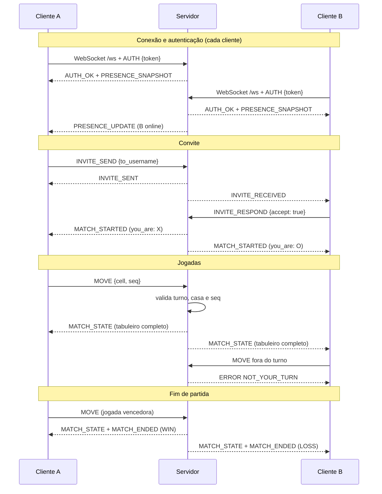

# Jogo da Velha Multiplayer

Jogo da velha para dois jogadores em tempo real pela rede, com servidor autoritativo em FastAPI, comunicação por WebSocket e cliente web em React.

<!-- TODO: gravar um GIF de uma partida entre duas abas e salvar em docs/demo.gif -->


## Sobre o projeto

Este é um projeto de estudo que desenvolvemos em equipe para aplicar, na prática, conceitos de redes de computadores. Os tópicos foram:

- arquitetura cliente-servidor;
- sockets e WebSocket sobre TCP;
- definição de um protocolo de aplicação próprio;
- TLS;
- tratamento de falhas de conexão.

O servidor é a única fonte da verdade: ele valida cada jogada, controla o tempo de turno e decide o fim da partida. Os clientes apenas exibem o estado que recebem.

## Funcionalidades

- Cadastro e login, com senha armazenada como hash Argon2id e sessão por token JWT
- Bloqueio temporário após tentativas de login malsucedidas repetidas
- Lobby com a lista de jogadores online e o status de cada um (livre ou em partida), atualizada em tempo real
- Convites entre jogadores: enviar, aceitar, recusar e cancelar, com expiração automática
- Partida entre dois jogadores com validação de jogadas no servidor (turno, casa ocupada, casa inválida, estado desatualizado)
- Detecção de vitória, com a linha vencedora destacada, e de empate
- Tempo de turno de 30 s; ao esgotar, o adversário vence
- Desistência durante a partida
- Reconexão: se um jogador cai, tem 30 s para voltar e retomar a partida de onde parou
- Sessão única por usuário: abrir a conta em outra aba encerra a conexão anterior
- Ranking de jogadores (vitória = 3 pontos, empate = 1) e histórico das últimas partidas
- Proteções no WebSocket: limite de mensagens por segundo, tamanho máximo de mensagem e verificação de origem
- Logs estruturados em JSON e trilha de auditoria no MongoDB, sem senhas nem tokens
- HTTPS/WSS com Nginx, usando certificado local (mkcert) no desenvolvimento e Let's Encrypt em produção

## Tecnologias

| Camada | Tecnologias |
| --- | --- |
| Back-end | Python 3.14, FastAPI, Uvicorn, Pydantic, PyMongo (API assíncrona), argon2-cffi, PyJWT |
| Front-end | React 19, TypeScript, Vite, React Router |
| Banco de dados | MongoDB 8.0 |
| Rede e infraestrutura | WebSocket, Nginx (proxy reverso e terminação TLS), Docker Compose, certbot / Let's Encrypt, mkcert |
| Testes e qualidade | pytest, pytest-asyncio, httpx, Playwright, ruff, ESLint, Prettier |

## Arquitetura

A arquitetura é cliente-servidor. O cliente web usa uma API REST para cadastro, login, ranking e histórico, e um WebSocket (`/ws`) para tudo que acontece em tempo real: presença, convites e partida. Em produção, o Nginx termina o TLS, serve o front-end e encaminha `/api` e `/ws` ao back-end.

- **Fonte da verdade:** o estado das partidas fica no servidor. A cada jogada válida, ele envia o tabuleiro completo aos dois jogadores. Um número de sequência (`seq`) permite recusar jogadas feitas sobre um estado desatualizado.
- **Concorrência:** o servidor roda em um único processo assíncrono (asyncio). O gateway WebSocket publica os comandos em um barramento de eventos interno. O motor do jogo serializa as alterações de estado com um `asyncio.Lock`. Os timers de turno, de convite e de reconexão são tarefas assíncronas.
- **Desconexões:** o ping/pong do WebSocket detecta conexões mortas. Se um jogador cai durante a partida, o adversário é avisado e abre-se uma janela de reconexão. Se o prazo acabar, a partida termina por desconexão. O cliente tenta reconectar com espera exponencial.
- **Persistência:** o MongoDB guarda usuários, estatísticas, partidas encerradas e eventos de auditoria.



## Protocolo

Toda mensagem do WebSocket é um objeto JSON com o envelope `{type, id, ref, ts, payload}`. O `ref` liga uma resposta ou um erro à mensagem que os originou. A especificação completa, com códigos de erro e de fechamento, está em [docs/protocolo.md](docs/protocolo.md).

| Direção | Mensagem | Payload | Descrição |
| --- | --- | --- | --- |
| C → S | `AUTH` | `{token}` | Primeira mensagem obrigatória (até 5 s) |
| C → S | `INVITE_SEND` | `{to_username}` | Convida um jogador |
| C → S | `INVITE_RESPOND` | `{match_id, accept}` | Aceita ou recusa o convite |
| C → S | `INVITE_CANCEL` | `{match_id}` | Cancela um convite pendente |
| C → S | `MOVE` | `{match_id, cell, seq}` | Jogada na casa 0–8 |
| C → S | `FORFEIT` | `{match_id}` | Desiste da partida |
| C → S | `MATCH_SYNC` | `{match_id}` | Pede o estado completo (após reconexão) |
| S → C | `AUTH_OK` | `{user, active_match_id}` | Autenticação aceita |
| S → C | `PRESENCE_SNAPSHOT` / `PRESENCE_UPDATE` | `{users}` / `{username, status}` | Jogadores online e seus status |
| S → C | `INVITE_SENT` / `INVITE_RECEIVED` | `{match_id, …, expires_in}` | Convite enviado / recebido |
| S → C | `INVITE_RESULT` | `{match_id, status}` | Convite recusado, expirado ou cancelado |
| S → C | `MATCH_STARTED` | `{match_id, you_are, opponent, board, turn, seq}` | Início da partida |
| S → C | `MATCH_STATE` | `{match_id, board, turn, seq, last_move}` | Estado após cada jogada |
| S → C | `MATCH_ENDED` | `{match_id, result, reason, winning_line, board}` | Fim: vitória, derrota ou empate |
| S → C | `OPPONENT_DISCONNECTED` / `OPPONENT_RECONNECTED` | `{match_id, grace_seconds}` / `{match_id}` | Queda e retorno do adversário |
| S → C | `ERROR` | `{code, message}` | Comando recusado (ex.: `NOT_YOUR_TURN`, `CELL_OCCUPIED`, `STALE_STATE`) |

## Como executar

### Pré-requisitos

- Docker com o plugin Compose
- Node.js LTS
- Python 3.14, apenas para rodar os testes do back-end fora do Docker

### Desenvolvimento

1. Crie o `.env` a partir do exemplo. Os valores do exemplo servem apenas para desenvolvimento.

   ```bash
   cp .env.example .env
   ```

2. Suba o MongoDB e o back-end:

   ```bash
   docker compose up -d --build
   ```

3. Em outro terminal, rode o front-end:

   ```bash
   cd frontend
   npm install
   npm run dev
   ```

4. Acesse http://localhost:5173 em duas abas ou dois navegadores, cadastre dois usuários e convide um para jogar. O Vite encaminha `/api` e `/ws` para o back-end em `http://localhost:8000`. O health check fica em http://localhost:8000/api/health.

### HTTPS local (opcional)

Com o [mkcert](https://github.com/FiloSottile/mkcert) instalado:

```bash
mkcert -install
mkdir -p infra/certs
mkcert -cert-file infra/certs/localhost.pem -key-file infra/certs/localhost-key.pem localhost 127.0.0.1 ::1
docker compose --profile https up -d --build
```

Acesse https://localhost.

### Variáveis de ambiente

| Variável | Descrição |
| --- | --- |
| `MONGO_ROOT_USER`, `MONGO_ROOT_PASSWORD` | Usuário administrador do MongoDB |
| `MONGO_APP_USER`, `MONGO_APP_PASSWORD`, `MONGO_DB`, `MONGO_URI` | Usuário da aplicação e conexão com o banco |
| `JWT_SECRET` | Segredo de assinatura do JWT (mínimo de 32 caracteres; gere com `openssl rand -hex 32`) |
| `JWT_EXPIRES_MINUTES` | Validade do token |
| `ALLOWED_ORIGINS` | Origens aceitas no handshake do WebSocket, separadas por vírgula |
| `INVITE_TIMEOUT_S`, `RECONNECT_GRACE_S` | Expiração de convites e janela de reconexão (padrão: 30 s) |
| `WS_RATE_PER_SECOND`, `WS_RATE_BURST`, `WS_MAX_MESSAGE_BYTES` | Limites do WebSocket |
| `LOG_LEVEL`, `SERVER_PORT`, `AUDIT_ENABLED` | Log e auditoria |
| `DOMAIN`, `LETSENCRYPT_EMAIL` | Apenas em produção |

Para implantação em produção (Nginx + Let's Encrypt), veja [infra/deploy/README.md](infra/deploy/README.md).

## Como rodar os testes

### Back-end (unidade e integração)

Os testes de integração usam o MongoDB do Docker, então mantenha o `docker compose` no ar.

```bash
cd backend
python3.14 -m venv .venv
source .venv/bin/activate        # Windows: .venv\Scripts\activate
pip install -r requirements-dev.txt
ruff check . && ruff format --check .
pytest                           # ou: pytest tests/unit  |  pytest tests/integration
```

### Front-end (lint e build)

```bash
cd frontend
npm run lint
npm run format:check
npm run build
```

### Ponta a ponta (Playwright)

Por padrão, o Playwright sobe um servidor falso na porta 8000 e o Vite na porta 5173. Pare o back-end do Docker antes (`docker compose stop backend`).

```bash
cd frontend
npx playwright install chromium   # apenas na primeira vez
npm run e2e
```

Para rodar contra o sistema real com HTTPS: `E2E_BASE_URL=https://localhost E2E_NO_SERVER=1 npm run e2e`.

## Documentação

- [Documentação técnica](docs/documentacao.md): requisitos, arquitetura, protocolo, segurança, análise de tráfego com Wireshark (com e sem TLS), implantação e testes
- [Protocolo de comunicação](docs/protocolo.md): contrato completo entre cliente e servidor
- [Deploy em produção](infra/deploy/README.md): Nginx, Let's Encrypt, atualização e backup

## Minha contribuição

Atuei principalmente em dados, segurança e infraestrutura, além de trabalhar na lógica de partida do servidor:

- **Estrutura do projeto:** criei o repositório, os esqueletos do back-end (FastAPI) e do front-end (React + Vite), o ambiente Docker Compose com MongoDB e a primeira versão do protocolo de comunicação.
- **Autenticação:** implementei o cadastro, o login e a rota `/api/me`, com hash Argon2id, tokens JWT e bloqueio após tentativas repetidas de login.
- **Ranking:** implementei o ranking de jogadores e a atualização das estatísticas ao fim de cada partida.
- **Ciclo de vida da partida:**
  - centralizei o encerramento das partidas (vitória, empate, desistência, tempo esgotado);
  - implementei a validação por número de sequência;
  - completei o fluxo de convites e a sessão única por usuário, com retomada da partida.
- **Reconexão:** implementei a janela de reconexão durante a partida, com aviso ao adversário e suspensão do tempo de turno.
- **Segurança do WebSocket:** implementei o limite de taxa (token bucket), o limite de tamanho de mensagem e a validação de origem.
- **Observabilidade:** implementei os logs estruturados e a gravação dos eventos da aplicação no MongoDB, com remoção de dados sensíveis.
- **Infraestrutura:** configurei o Nginx com HTTPS/WSS e o deploy em produção com Let's Encrypt e renovação automática do certificado.
- **Integração e documentação:** alinhei o contrato de mensagens entre front-end e back-end, reforcei os testes do back-end e escrevi a documentação técnica. A documentação inclui diagramas e análise do tráfego com Wireshark, comparando a comunicação com e sem TLS.

## Equipe

- Rodrigo Arraes
- William Mendonça
- Luiz Moura <!-- TODO: confirmar o nome a exibir e se "Theardripper" (autor dos commits do front-end) é a mesma pessoa ou um quarto integrante -->
