---
puppeteer:
  format: "A4"
  printBackground: true
  margin:
    top: "18mm"
    bottom: "18mm"
    left: "16mm"
    right: "16mm"
---

<style>
pre, pre[class*="language-"], pre code, code[class*="language-"] { white-space: pre-wrap !important; word-break: break-word !important; overflow-wrap: anywhere !important; }
table { width: 100%; table-layout: auto; }
td code { word-break: break-all; }
img { max-width: 100%; }
html body { font-size: 14px !important; line-height: 1.5 !important; }
html body table { font-size: 12.5px !important; }
html body pre, html body code, html body pre code { font-size: 12px !important; }
</style>

<div style="height: 250mm; display: flex; flex-direction: column; justify-content: space-between; text-align: center; font-family: 'Times New Roman', Times, serif;">
<div>
<p style="font-size: 12pt; margin-top: 18px; line-height: 1.6;">LUIZ EDUARDO DA SILVA MOURA<br>RODRIGO ARRAES COSTA ALBUQUERQUE<br>WILLIAM MENDONÇA OLIVEIRA</p>
</div>
<div>
<p style="font-weight: bold; font-size: 13pt; line-height: 1.5;">JOGO DA VELHA MULTIPLAYER<br>DOCUMENTAÇÃO TÉCNICA</p>
</div>
<div>
<p style="font-size: 12pt; line-height: 1.5;">BRAZIL<br>2026</p>
</div>
</div>

<div style="page-break-after: always;"></div>

# Jogo da Velha Multiplayer

**Documentação técnica do projeto**

| Integrante | Papel |
| --- | --- |
| William | A: back-end em tempo real (regras do jogo, event bus, WebSocket) |
| Rodrigo Arraes | B: dados, segurança e infraestrutura |
| Luiz Eduardo | C: front-end (telas e estado do cliente) |

A aplicação foi implantada em produção em uma VM na nuvem (`<domínio de produção>`); o ambiente está desativado.

## Sumário

- [1. Introdução e escopo](#introducao)
- [2. Requisitos](#requisitos)
- [3. Arquitetura e componentes de rede](#arquitetura)
- [4. Escolha das tecnologias e bibliotecas](#tecnologias)
- [5. Comunicação: sockets, IPC e protocolo](#comunicacao)
- [6. Sequência da comunicação e roteamento de mensagens](#sequencia)
- [7. Modelo de dados](#modelo-de-dados)
- [8. Segurança](#seguranca)
- [9. Monitoramento e depuração](#monitoramento)
- [10. Implantação](#implantacao)
- [11. Testes](#testes)
- [12. Decisões e qualidade](#decisoes-e-qualidade)
- [13. Referências](#referencias)

Documentos técnicos complementares, citados ao longo do texto:

- `docs/protocolo.md`: contrato completo entre cliente e servidor (rotas REST, catálogo de mensagens WebSocket, códigos de erro e de fechamento).
- `infra/deploy/README.md`: procedimento de implantação em produção (firewall, Docker, certificado, atualização e backup).

<div style="page-break-after: always;"></div>

## 1. Introdução e escopo {#introducao}

O objetivo do projeto é uma aplicação de jogo para dois jogadores conectados ao mesmo tempo por uma rede, com estado de jogo consistente para ambos. Escolhemos o jogo da velha porque as regras são curtas e conhecidas. Assim, o esforço do projeto ficou concentrado nos temas que o projeto se propôs a explorar: comunicação em rede, protocolo, segurança, arquitetura orientada a eventos e observabilidade.

A aplicação segue o modelo cliente-servidor. O cliente é uma aplicação web em React, executada no navegador. O servidor é escrito em Python com FastAPI e é a única fonte de verdade da partida: o cliente envia intenções (convidar, jogar na casa 4, desistir) e o servidor decide se elas valem, atualiza o estado e o envia aos dois jogadores. O MongoDB guarda usuários, resultados de partidas e eventos de execução. Em produção, um Nginx termina o TLS e é o único ponto de entrada público.

O que entregamos, em linhas gerais:

- cadastro e login com senha protegida por Argon2id e sessão por token JWT;
- lista de usuários online atualizada em tempo real;
- convites com aceite, recusa, cancelamento e expiração em 30 s;
- partida em tempo real por WebSocket, com turno de 30 s, desistência e resultado para os dois lados;
- ranking público por pontos;
- reconexão a uma partida em andamento dentro de 30 s;
- registro estruturado dos eventos do servidor, persistido no banco;
- implantação em uma VM no Azure, com HTTPS e WSS por certificado Let's Encrypt.

Ficaram fora do escopo o jogador bot e o painel de administração (requisitos opcionais 11 e 13), como detalhado na seção 2.

## 2. Requisitos {#requisitos}

### 2.1 Requisitos básicos {#requisitos-basicos}

Todos os requisitos básicos foram implementados. A tabela indica como cada um foi atendido e em que seção do documento está o detalhe.

| # | Requisito | Como atendemos | Seções |
| --- | --- | --- | --- |
| 1 | Cadastro de múltiplos usuários com persistência segura | Senha só como hash Argon2id; `username` único, em minúsculas | 7, 8 |
| 2 | Autenticar sem expor dados de registro | JWT de 60 min, erro genérico no login, TLS em produção, nada sensível no log | 8 |
| 3 | Exibir usuários online | `PRESENCE_SNAPSHOT` na entrada e `PRESENCE_UPDATE` a cada mudança | 5, 6 |
| 4 | Criar jogo e convidar usuário online | `INVITE_SEND`, com recusa de usuário offline, ocupado ou do próprio usuário | 6 |
| 5 | Aceitar ou recusar convite | `INVITE_RESPOND`: aceite gera `MATCH_STARTED`, recusa gera `INVITE_RESULT` | 6 |
| 6 | Jogar na sua vez, com tabuleiro atualizado para os dois | `MOVE` validado pelo servidor; `MATCH_STATE` com o tabuleiro inteiro para ambos | 5, 6 |
| 7 | Mostrar o resultado final para os dois | `MATCH_ENDED` com `result` do ponto de vista de cada jogador e o motivo | 6 |
| 8 | Sair do jogo concedendo a vitória | `FORFEIT`, ou queda sem retorno em 30 s | 6 |
| 9 | Monitorar eventos do servidor e, de preferência, persistir no banco | Log JSON de cada evento, gravado também na coleção `events` | 9 |

### 2.2 Requisitos opcionais {#requisitos-opcionais}

| # | Requisito | Situação | Observação |
| --- | --- | --- | --- |
| 10 | Placar | Feito | `GET /api/ranking`: vitória vale 3 pontos e empate 1; desempate por vitórias e depois por menos derrotas |
| 11 | Jogador bot | Não feito | Priorizamos reconexão e implantação, que reforçam os temas de rede do projeto |
| 12 | Simulação e recuperação de falhas | Feito | Janela de reconexão de 30 s (seção 6.5) |
| 13 | Painel do servidor | Não feito | Os dados necessários já existem na coleção `events`; ver próximos passos na seção 12 |
| 14 | Implantação na nuvem | Feito | VM Ubuntu no Azure, Docker Compose com override de produção, TLS 1.3 com Let's Encrypt |

### 2.3 Requisitos não funcionais {#requisitos-nao-funcionais}

Os requisitos não funcionais foram definidos na fase de projeto, cada um com um critério verificável.

| ID | Categoria | Critério | Situação |
| --- | --- | --- | --- |
| RNF01 | Segurança | TLS 1.2 ou superior; nada legível na porta 443 no Wireshark | Atendido: TLS 1.3 em produção, senha não encontrada na captura (seção 8) |
| RNF02 | Segurança | Senhas armazenadas só como hash Argon2id e nunca registradas em log | Atendido (seções 7 e 8) |
| RNF03 | Consistência | Servidor como única fonte de verdade; os dois clientes exibem o mesmo tabuleiro (mesmo `seq`) | Atendido: tabuleiro inteiro em cada `MATCH_STATE` (seção 5) |
| RNF04 | Desempenho | Uma jogada aparece no adversário em menos de 200 ms | Atendido: cerca de 3 ms em loopback e cerca de 100 a 130 ms estimados pela internet (seção 9.5) |
| RNF05 | Escalabilidade | Nenhum limite fixo de usuários ou partidas; teste com 5 partidas paralelas | Sem limite no código; teste discutido na seção 11 |
| RNF06 | Robustez | Erros e quedas de um cliente não afetam o servidor nem outras partidas | Atendido: validação estrita e falha de handler isolada (seções 3 e 5) |
| RNF07 | Observabilidade | Todo evento relevante gera log JSON com horário, tipo, usuário e partida | Atendido (seção 9) |
| RNF08 | Usabilidade | No máximo 2 cliques até convidar; turno e resultado visíveis | Atendido: 1 clique em "Convidar" |
| RNF09 | Portabilidade | Ambiente completo sobe com `docker compose up` em Windows, Linux ou macOS | Atendido: desenvolvimento em Windows, produção em Ubuntu |
| RNF10 | Manutenibilidade | Regras do jogo em módulo puro, com testes unitários | Regras em `backend/app/domain/`, com testes; cobertura não medida |

## 3. Arquitetura e componentes de rede {#arquitetura}

### 3.1 Visão geral {#visao-geral}

A arquitetura segue o modelo cliente-servidor clássico: clientes, cada um com seu socket, ligados pela rede a um servidor de aplicação que contém o barramento de eventos e o banco de dados. Acrescentamos um Nginx à frente do servidor para terminar o TLS e servir o front-end.

<div style="page-break-inside: avoid">

**Diagrama D1: componentes do sistema**

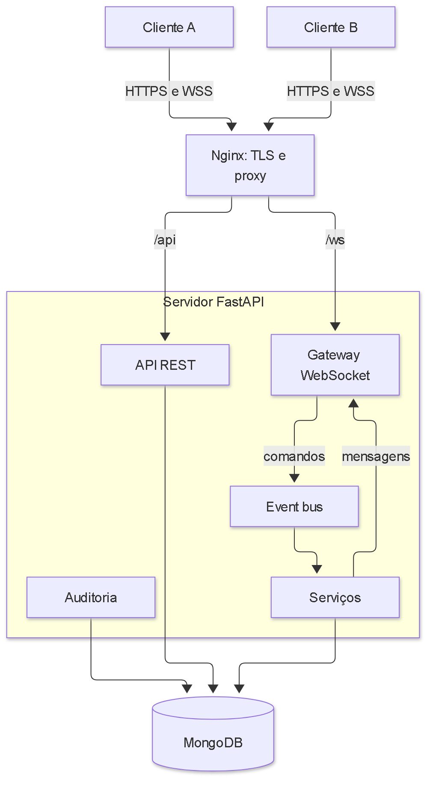

</div>

### 3.2 Responsabilidade de cada componente {#componentes}

| Componente | Responsabilidade |
| --- | --- |
| Cliente React | Telas; envia comandos e exibe o estado recebido, sem decidir turno nem resultado |
| Nginx | TLS, arquivos estáticos do React e encaminhamento de `/api` e `/ws` ao servidor |
| API REST | Cadastro, login (JWT), ranking, histórico e health check |
| Gateway WebSocket | Autentica a conexão, valida as mensagens, aplica limites e publica comandos no event bus |
| Event bus | Publicação e assinatura de eventos internos; cumpre o papel de corretor (broker) de mensagens |
| Serviços | Presença, convites, partidas e ranking |
| Auditoria | Grava os eventos de log na coleção `events` por uma fila assíncrona |
| MongoDB | Persiste `users`, `matches` (resultados) e `events` |

### 3.3 Servidor autoritativo e estado em memória {#estado-em-memoria}

O servidor é autoritativo: o cliente nunca altera o tabuleiro por conta própria. Esse modelo resolve consistência e trapaça ao mesmo tempo: os dois clientes substituem o estado local pelo que o servidor envia, e um cliente adulterado não consegue jogar fora da vez nem em casa ocupada.

O estado de tempo real fica em memória, em três estruturas: `ConnectionManager` (conexões e presença), `InviteService` (convites pendentes e seus temporizadores) e `GameEngineService` (partidas ativas por `match_id`). O banco recebe apenas o resultado de cada partida, no momento em que ela termina; a seção 7.4 explica essa decisão.

A consequência dessa escolha é que o servidor roda com um único processo Uvicorn (um worker): dois processos teriam duas cópias independentes de presença e partidas. Para a escala do projeto, um processo é suficiente, e o limite está registrado na seção 12.

### 3.4 Event bus e concorrência {#event-bus}

O gateway não chama os serviços diretamente. Cada comando recebido vira um evento `cmd.<tipo>`, publicado no `EventBus`. O `publish` cria uma tarefa assíncrona para cada handler inscrito. Com isso, o gateway volta a ler o socket sem esperar o processamento, e uma exceção em um handler é registrada como `error.internal` sem interromper os demais. Se não houver nenhum handler para o tipo recebido, o gateway responde `UNKNOWN_TYPE`.

Como os handlers rodam em tarefas concorrentes, o `GameEngineService` serializa o acesso às partidas com uma única trava (`asyncio.Lock`), escolhida pela simplicidade. Uma partida de jogo da velha gera poucas mensagens, e dentro da trava só há operações em memória: a gravação do resultado no banco acontece depois que ela é liberada. O `seq` (seção 5.5) recusa a segunda de duas jogadas simultâneas. Uma trava por partida, que permitiria paralelismo entre partidas, está entre os próximos passos da seção 12.

### 3.5 Camadas do servidor {#camadas}

O módulo `domain/` contém as regras puras do jogo e não importa FastAPI, PyMongo nem nada de rede. Somente `repositories/` acessa o banco. A configuração vem apenas de variáveis de ambiente, lidas em `core/config.py`.

<div style="page-break-inside: avoid">

**Diagrama D3: camadas internas do servidor**

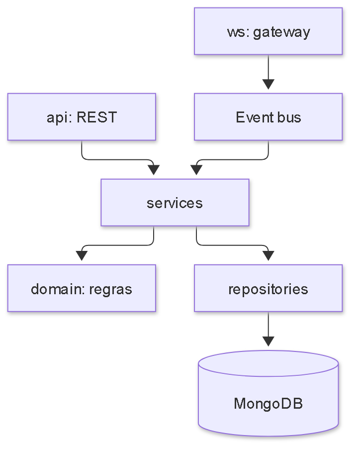

</div>

A auditoria não aparece no diagrama porque não depende do event bus: ela recebe os registros do módulo `logging` do Python, inclusive os gerados pela API REST (seção 9.2).

### 3.6 Rede e portas {#rede-e-portas}

<div style="page-break-inside: avoid">

**Diagrama D2: rede e implantação em produção**

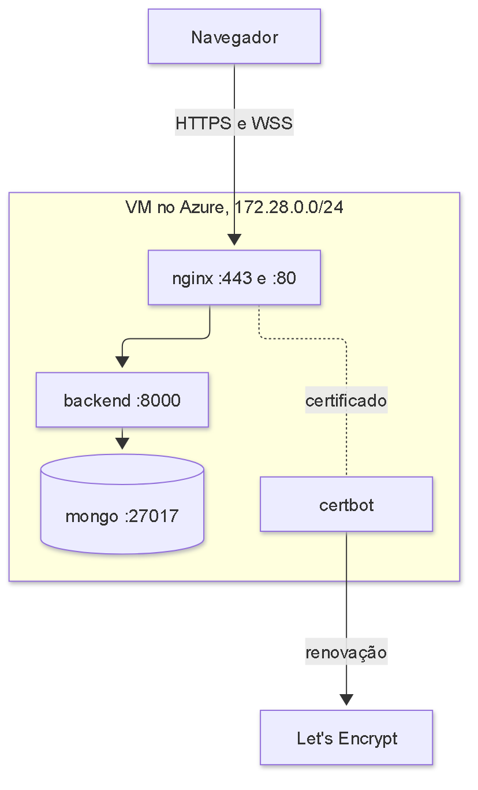

</div>

Em produção, só as portas 22, 80 e 443 são liberadas, e o backend e o MongoDB não publicam portas. O backend só aceita `X-Forwarded-For` vindo do IP fixo do Nginx, de modo que o IP registrado no log é o do cliente real.

| Porta | Desenvolvimento | Produção |
| --- | --- | --- |
| 443 / 80 | Nginx com mkcert (profile `https`) | Nginx com Let's Encrypt |
| 5173 | Vite, com proxy para a 8000 | Não usada |
| 8000 | Backend no host | Só na rede interna |
| 27017 | MongoDB em `127.0.0.1` | Só na rede interna |

## 4. Escolha das tecnologias e bibliotecas {#tecnologias}

### 4.1 Por que Python no servidor {#python}

Avaliamos também .NET (C#) e Java. Escolhemos Python 3.14 pelos motivos abaixo.

**Concorrência de E/S.** O servidor passa quase todo o tempo esperando rede e banco. Com `asyncio`, cada conexão WebSocket é uma corrotina leve no mesmo laço de eventos, sem uma thread por cliente.

**Validação do protocolo.** O Pydantic descreve cada payload como um modelo tipado. Usamos tipos estritos (`StrictInt`, `StrictStr`, `StrictBool`), de modo que `"cell": "4"` é recusado com `INVALID_MESSAGE` em vez de ser convertido silenciosamente.

**Bibliotecas mantidas e documentadas.** FastAPI, Uvicorn, Pydantic e PyMongo são bibliotecas bem documentadas, robustas e amplamente utilizadas.

**Produtividade.** A familiaridade da equipe com Python permitiu entregar servidor, testes de unidade e de integração dentro do prazo planejado.

As alternativas avaliadas têm recursos equivalentes: `ASP.NET` Core com SignalR e Spring com suporte a WebSocket. O SignalR, porém, acrescenta um protocolo próprio sobre o WebSocket, com o mesmo efeito do `Socket.IO` discutido em 4.3. Para um protocolo que queríamos projetar e mostrar no Wireshark, o WebSocket nativo do FastAPI atende melhor.

### 4.2 Bibliotecas e ferramentas {#bibliotecas}

| Camada | Escolha | Versão | Motivo |
| --- | --- | --- | --- |
| Framework web | FastAPI | 0.143.0 | REST e WebSocket no mesmo aplicativo |
| Servidor ASGI | Uvicorn (`[standard]`) | 0.54.0 | WebSocket com ping/pong de protocolo a cada 20 s |
| Validação e configuração | Pydantic v2 e pydantic-settings | 2.15.0 | Modelos das mensagens e configuração validada por variáveis de ambiente |
| Banco de dados | MongoDB | 8.0 | Resultados e eventos com `details` variável cabem em documentos |
| Driver do banco | PyMongo, API assíncrona | 4.18.2 | Driver oficial, substituto do Motor |
| Hash de senha | argon2-cffi (Argon2id) | 25.1.0 | Hash de senha lento e com custo de memória |
| Token de sessão | PyJWT (HS256) | 2.15.1 | Token assinado e com expiração, validado sem consulta ao banco |
| Front-end | React 19, TypeScript 6.0 e Vite 8 | 19.2 / 6.0 / 8.3 | Estado do lobby e da partida em contextos; contrato tipado |
| Roteamento no cliente | React Router | 7 | Rotas protegidas e retorno a `/match/<id>` na reconexão |
| Proxy e TLS | Nginx (`stable-alpine`) | estável | TLS, arquivos estáticos e upgrade de `/ws` fora do Python |
| Certificados | mkcert (local) e certbot (produção) | certbot 5.8.0 | Certificado confiável local e renovação automática em produção |
| Orquestração | Docker Compose | | Mesmo ambiente em Windows, Linux e na VM |
| Testes | pytest, pytest-asyncio, Playwright | 9.1, 1.4, 1.64 | Integração com MongoDB real e ponta a ponta com dois navegadores |
| Qualidade | ruff, ESLint, Prettier | 0.16, 10, 3.9 | Lint e formatação sem avisos nos dois lados |

### 4.3 WebSocket nativo, `Socket.IO` ou MQTT {#websocket-socketio-mqtt}

| Opção | Vantagem | Por que não usamos |
| --- | --- | --- |
| WebSocket nativo (RFC 6455) | Padrão do navegador; frames de texto com o nosso JSON, legíveis no Wireshark | Escolhido |
| `Socket.IO` | Reconexão e salas prontas | Protocolo próprio sobre o WebSocket: o protocolo analisado passaria a ser o da biblioteca, e não o nosso |
| MQTT | Modelo publicação/assinatura com broker | Exigiria um broker externo; o event bus interno já cumpre o papel de corretor (seção 3.4) |

Sem a reconexão de uma biblioteca pronta, o cliente tenta de novo com espera de 1, 2, 4 s, até 30 s, exceto após 4001 (sessão em outra aba) e 4401 (token inválido), em que reconectar não resolveria.

## 5. Comunicação: sockets, IPC e protocolo {#comunicacao}

### 5.1 Sockets e WebSocket {#sockets}

Um dos objetivos do projeto é entender o uso de sockets no contexto do modelo OSI e comunicar dados entre cliente-servidor e cliente-cliente. Um navegador não abre um socket TCP diretamente; a forma padrão de obter um canal TCP persistente e bidirecional em uma aplicação web é o WebSocket. A conexão começa como uma requisição HTTP `GET /ws` com o cabeçalho `Upgrade: websocket`. O servidor responde `101 Switching Protocols` e, a partir daí, a mesma conexão TCP transporta frames nos dois sentidos até o fechamento.

Escolhemos TCP, e não UDP, porque um jogo por turnos não pode perder nem reordenar jogadas, e a latência de um jogo da velha não justifica reimplementar essas garantias na aplicação.

<div style="page-break-inside: avoid">

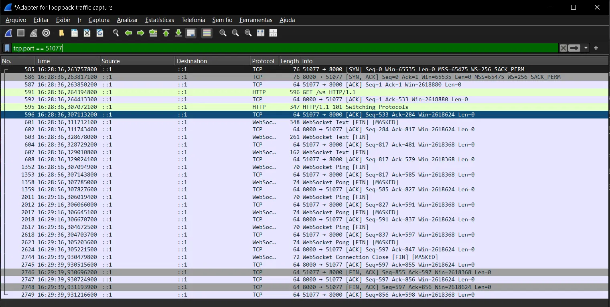

*Figura 1. Conexão WebSocket filtrada por `tcp.port == 51077`: handshake TCP, upgrade, mensagens, ping/pong a cada 20 s e fechamento.*

</div>

Nas capturas locais, o front-end foi servido pelo Vite: o navegador se conecta ao Vite na porta 5173, e o Vite abre uma segunda conexão até o backend na porta 8000. A porta 51077 da Figura 1 é a dessa segunda conexão. Em produção, o Nginx ocupa o lugar do Vite, e o trecho entre o navegador e o servidor passa a ser cifrado (seção 8).

<div style="page-break-inside: avoid">

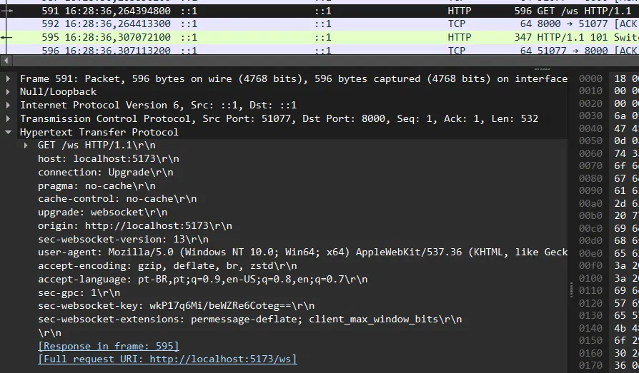

*Figura 2. Requisição `GET /ws` com os cabeçalhos de upgrade, que recebe a resposta `101 Switching Protocols` no frame 595.*

</div>

### 5.2 Comunicação cliente-cliente {#cliente-cliente}

Nesta arquitetura, a comunicação entre clientes é mediada pelo servidor: uma jogada de A chega a B porque o servidor a recebe, valida e encaminha. Não usamos conexão direta entre navegadores (WebRTC, por exemplo), que exigiria atravessar NAT e tiraria do servidor o controle das regras e da segurança.

### 5.3 Mapeamento no modelo OSI {#modelo-osi}

| Camada OSI | No projeto | Onde ver no Wireshark |
| --- | --- | --- |
| 7. Aplicação | Protocolo próprio em JSON; HTTP na API REST e no upgrade | `http` e `websocket` (sem TLS) |
| 6. Apresentação | JSON em UTF-8; criptografia TLS | `tls`: Client Hello e Server Hello |
| 5. Sessão | Sessão WebSocket autenticada pelo JWT; sessão TLS | Frames de controle Ping, Pong e Close |
| 4. Transporte | TCP, com entrega ordenada e confiável | SYN, SYN-ACK, ACK; filtro `tcp.stream` |
| 3. Rede | IPv6 em loopback; IPv4 até a VM | `ip.addr` ou `ipv6.addr` |
| 2 e 1. Enlace e física | Loopback local; Wi-Fi ou Ethernet pela rede | Cabeçalho do frame |

### 5.4 Comunicação entre processos (IPC) {#ipc}

| Canal | Processos | Transporte | Formato |
| --- | --- | --- | --- |
| Cliente e servidor, requisições | Navegador, Nginx e Uvicorn | HTTPS na 443; HTTP na rede interna | JSON; JWT no cabeçalho `Authorization` |
| Cliente e servidor, tempo real | Navegador, Nginx e Uvicorn | WSS na 443; WS na rede interna | Envelope JSON em frames de texto |
| Servidor e banco | Uvicorn e `mongod` | Protocolo do MongoDB sobre TCP 27017 | BSON |
| Dentro do servidor | Gateway, serviços e auditoria | Event bus e fila `asyncio.Queue` | Objetos `Event` e registros de log |

Separamos REST e WebSocket por natureza da operação. Cadastro, login, ranking e histórico são pedidos pontuais com resposta. Presença, convites e jogadas precisam que o servidor envie mensagens sem ter sido consultado, o que só um canal persistente oferece.

### 5.5 Protocolo de mensagens {#protocolo}

**Envelope.** Toda mensagem WebSocket, nos dois sentidos, tem o mesmo formato:

| Campo | Significado |
| --- | --- |
| `type` | Tipo da mensagem, em maiúsculas (por exemplo, `MOVE`) |
| `id` | Identificador único (UUID) gerado por quem envia |
| `ref` | Em respostas, o `id` do comando que as originou |
| `ts` | Horário de envio em ISO 8601 (UTC) |
| `payload` | Dados específicos do tipo |

Um envelope único facilita o roteamento no gateway e a depuração: todo frame tem a mesma estrutura.

**Catálogo.** O cliente envia 7 tipos de comando, e o servidor envia 12 tipos de mensagem:

| Grupo | Cliente para servidor | Servidor para cliente |
| --- | --- | --- |
| Autenticação | `AUTH` | `AUTH_OK` |
| Presença | | `PRESENCE_SNAPSHOT`, `PRESENCE_UPDATE` |
| Convites | `INVITE_SEND`, `INVITE_RESPOND`, `INVITE_CANCEL` | `INVITE_SENT`, `INVITE_RECEIVED`, `INVITE_RESULT` |
| Partida | `MOVE`, `FORFEIT`, `MATCH_SYNC` | `MATCH_STARTED`, `MATCH_STATE`, `MATCH_ENDED` |
| Reconexão | | `OPPONENT_DISCONNECTED`, `OPPONENT_RECONNECTED` |
| Erros | | `ERROR` |

O token não vai na URL do WebSocket, onde ficaria registrado em logs de proxy e no histórico do navegador. Ele segue na primeira mensagem, `AUTH`, que precisa chegar em até 5 s.

**Tabuleiro inteiro e número de sequência.** Cada `MATCH_STATE` traz o tabuleiro completo e um `seq` que cresce a cada jogada válida; o cliente apenas substitui o que tem, e uma mensagem perdida é corrigida pela seguinte. O cliente envia o `seq` que conhece junto com o `MOVE`, e um `seq` desatualizado, como num clique duplo, é recusado com `STALE_STATE`.

**Exemplo de jogada.** Os dois frames abaixo são a primeira jogada de uma partida, lidos da captura local com o tshark. O frame 4707 (16:30:20,826948) leva o `MOVE` do jogador X, do navegador até o proxy do Vite; é o mesmo frame da Figura 3.

```json
{"type": "MOVE",
 "id": "53ef54a8-2270-418b-bea0-5ded8c0fe43f",
 "ref": null,
 "ts": "2026-10-19T19:30:20.826Z",
 "payload": {"match_id": "4e544235-ec18-4ce9-bfb2-2ec5501a8627",
             "cell": 0, "seq": 0}}
```

O frame 4717 (16:30:20,830004) entrega ao jogador O o `MATCH_STATE`, com o `ref` igual ao `id` do `MOVE` e o `seq` em 1:

```json
{"type": "MATCH_STATE",
 "id": "eff6b74b-af91-487a-9241-57b4000f21a3",
 "ref": "53ef54a8-2270-418b-bea0-5ded8c0fe43f",
 "ts": "2026-10-19T19:30:20.829521+00:00",
 "payload": {"match_id": "4e544235-ec18-4ce9-bfb2-2ec5501a8627",
             "board": ["X", null, null, null, null, null, null, null, null],
             "turn": "O", "seq": 1,
             "last_move": {"symbol": "X", "cell": 0}}}
```

<div style="page-break-inside: avoid">

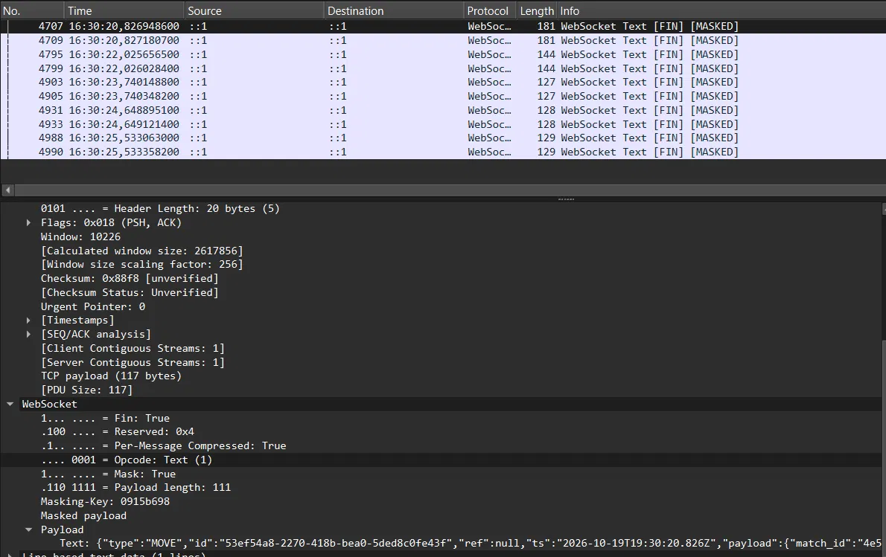

*Figura 3. Frame WebSocket com o comando `MOVE` em texto claro, enviado pelo cliente com máscara (`Mask: True`) e compressão `permessage-deflate`.*

</div>

A máscara, exigida pela RFC 6455 em todo frame do cliente, não é criptografia: a chave viaja no próprio frame. O Wireshark remove a máscara e descomprime o conteúdo, por isso, sem TLS, o JSON fica legível para qualquer um na rede.

**Erros e fechamento.** Comandos recusados geram `ERROR` com um de 13 códigos, e a conexão continua aberta; violações graves fecham a conexão com os códigos da seção 8.5. O contrato completo está no repositório, em `docs/protocolo.md`.

## 6. Sequência da comunicação e roteamento de mensagens {#sequencia}

Os diagramas omitem o envelope (`id`, `ref`, `ts`) e mostram só os campos do `payload` relevantes para cada passo.

### 6.1 Cadastro, login e entrada no lobby {#fluxo-login}

O JWT do login vale 60 minutos, e o `AUTH` precisa chegar em até 5 s. O `active_match_id` do `AUTH_OK` permite retomar uma partida depois de recarregar a página ou de uma queda (seção 6.5).

<div style="page-break-inside: avoid">

**Diagrama D5: cadastro, login e entrada no lobby**

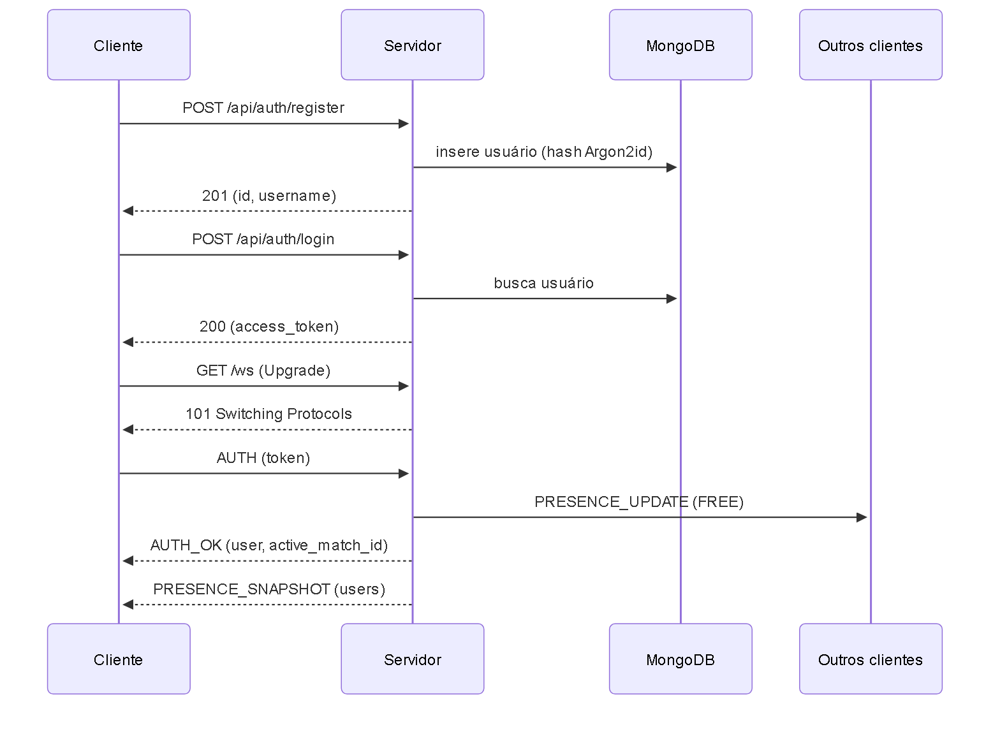

</div>

Se a mesma conta abrir uma segunda conexão, a anterior é fechada com 4001, sem `OFFLINE` para os outros usuários.

### 6.2 Convites {#fluxo-convite}

Antes de criar o convite, o servidor confere três condições e recusa com `ERROR` se alguma falhar: o convidado não pode ser o próprio usuário (`SELF_INVITE`), precisa estar online (`USER_OFFLINE`) e nenhum dos dois pode estar em partida ou em outro convite pendente (`USER_BUSY`). O convidante joga com X e começa.

<div style="page-break-inside: avoid">

**Diagrama D6: convite e suas alternativas**

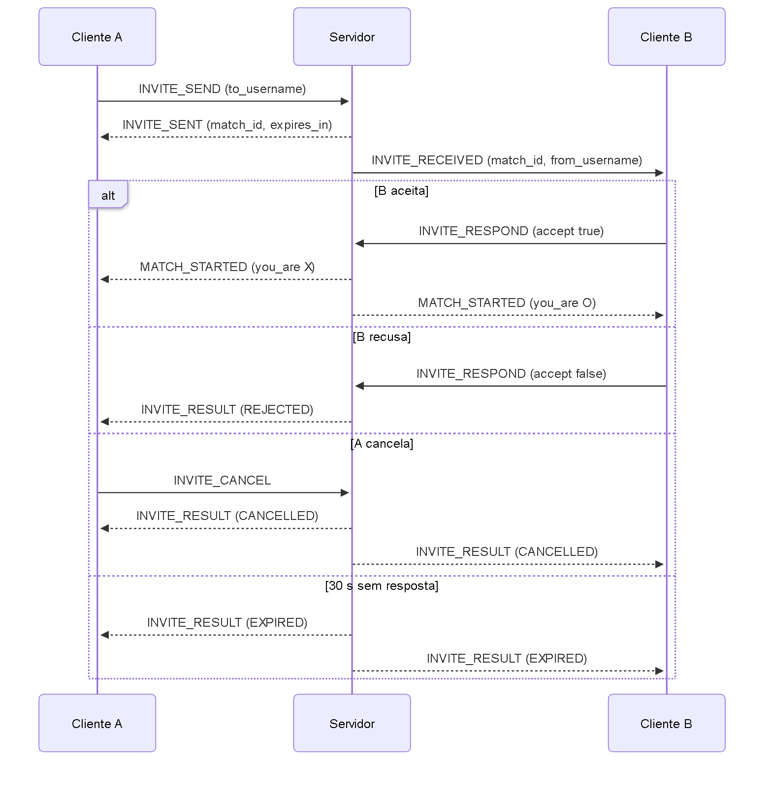

</div>

Além dos casos do diagrama, a queda de um dos dois encerra o convite com `CANCELLED` para quem ficou. Toda saída do estado pendente passa por um único método, que remove o convite e cancela o temporizador; assim, um aceite no mesmo instante da expiração não produz partida e `EXPIRED` ao mesmo tempo.

### 6.3 Jogada {#fluxo-jogada}

O motor valida a jogada dentro da trava global descrita na seção 3.4, nesta ordem: formato do payload (`INVALID_MESSAGE`), partida existente e em andamento (`MATCH_NOT_FOUND` ou `INVALID_STATE`), jogador da partida (`NOT_A_PLAYER`), `seq` atual (`STALE_STATE`) e, no módulo `domain/`, casa válida (`INVALID_CELL`), vez do jogador (`NOT_YOUR_TURN`) e casa livre (`CELL_OCCUPIED`).

<div style="page-break-inside: avoid">

**Diagrama D7: processamento de uma jogada**

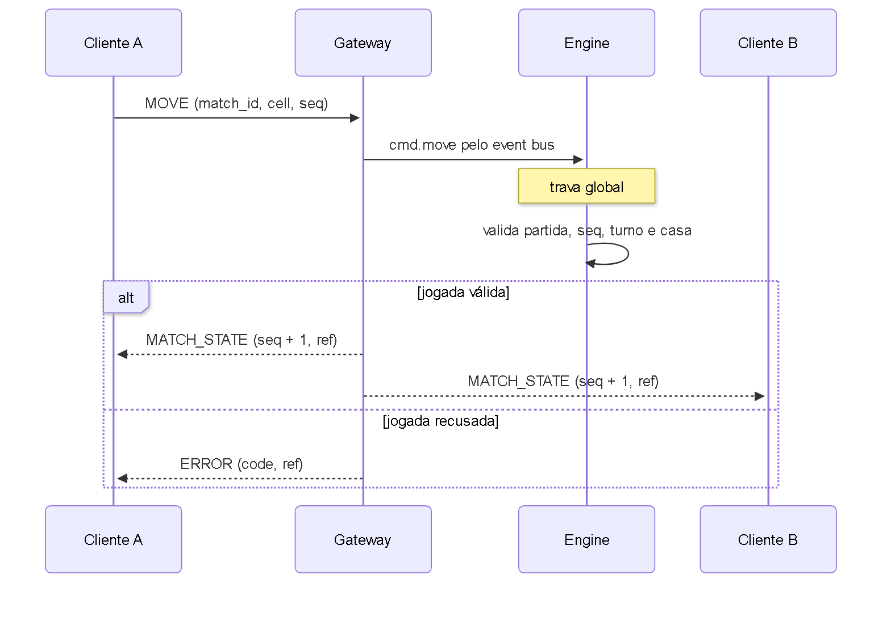

</div>

Uma jogada válida também reinicia o temporizador de 30 s do turno. No caso de `STALE_STATE`, o servidor envia ainda o `MATCH_STATE` atual a esse jogador, para que o cliente corrija a tela sem precisar pedir.

### 6.4 Fim de partida {#fluxo-fim}

Os cinco tipos de fim (`LINE`, `DRAW`, `FORFEIT`, `TIMEOUT` e `DISCONNECT`) passam por um único componente, o `MatchFinisher`, para terem os mesmos efeitos na mesma ordem.

<div style="page-break-inside: avoid">

**Diagrama D8: fim de partida**

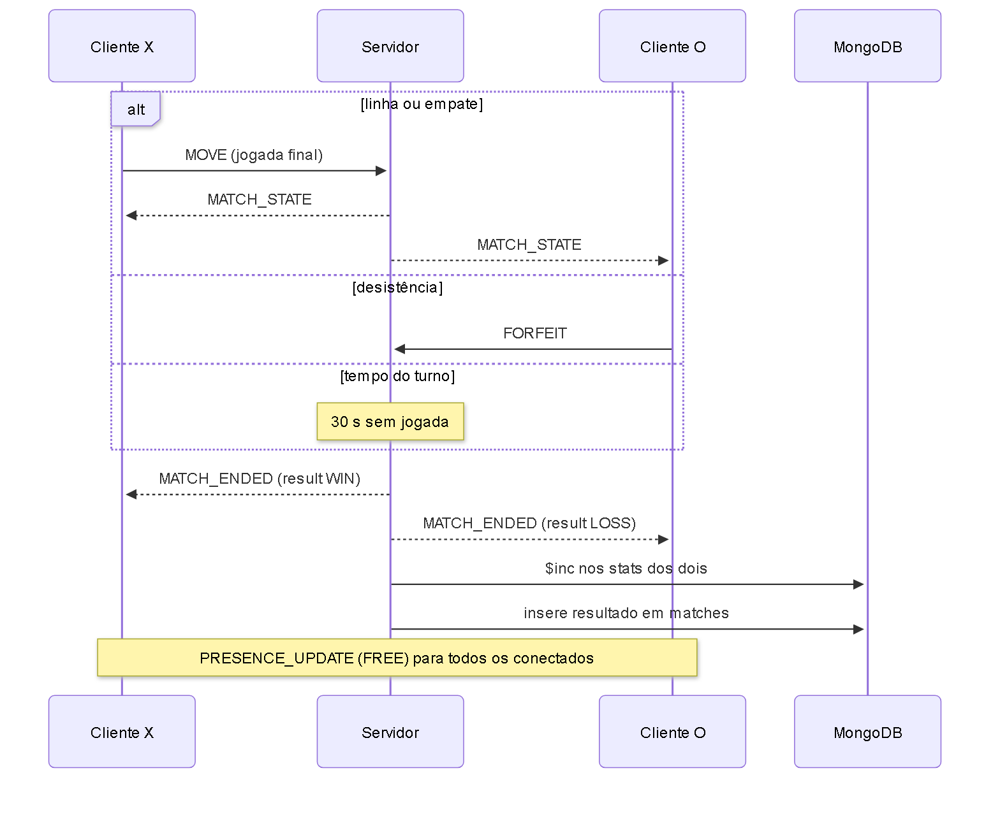

</div>

Quando a partida termina por jogada, o `MATCH_STATE` dessa jogada chega antes do `MATCH_ENDED`. Uma falha ao gravar o ranking ou o resultado é registrada como `error.internal` e não impede que os jogadores recebam o resultado e voltem ao lobby. No `TIMEOUT`, perde quem estava com a vez; no `FORFEIT` e no `DISCONNECT`, vence o adversário de quem saiu.

### 6.5 Queda e reconexão {#fluxo-reconexao}

Quando a conexão de um jogador cai durante uma partida, o servidor abre uma janela de 30 s (`RECONNECT_GRACE_S`) e suspende o temporizador do turno. Suspendemos o turno porque, sem isso, um jogador que caísse na própria vez poderia perder por `TIMEOUT` enquanto ainda tinha direito de voltar.

<div style="page-break-inside: avoid">

**Diagrama D9: queda e reconexão**

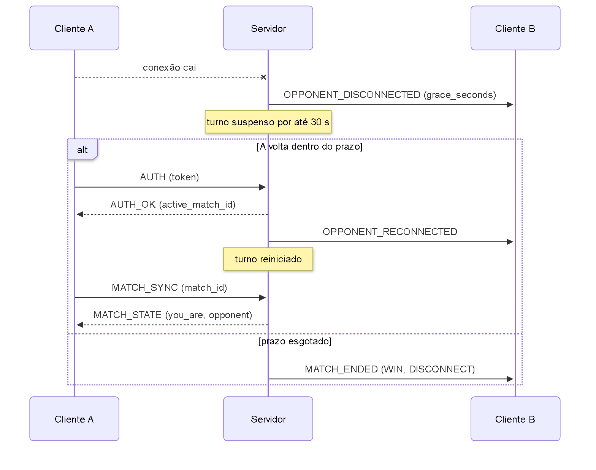

</div>

Na volta, o turno recomeça com 30 s completos, e a resposta ao `MATCH_SYNC` inclui o símbolo do jogador e o nome do adversário. O mesmo caminho atende quem recarrega a página. A troca de aba (4001) não abre janela de reconexão.

### 6.6 Estados da partida {#estados-partida}

Os nomes dos estados vêm do enum `MatchStatus`. Em memória, o estado não é um campo gravado: `PENDING` é um convite em `InviteService` e `IN_PROGRESS` é uma entrada no `GameEngineService`. Só o estado `FINISHED` chega ao banco, em `matches` (seção 7.4).

<div style="page-break-inside: avoid">

**Diagrama D10: ciclo de vida da partida**

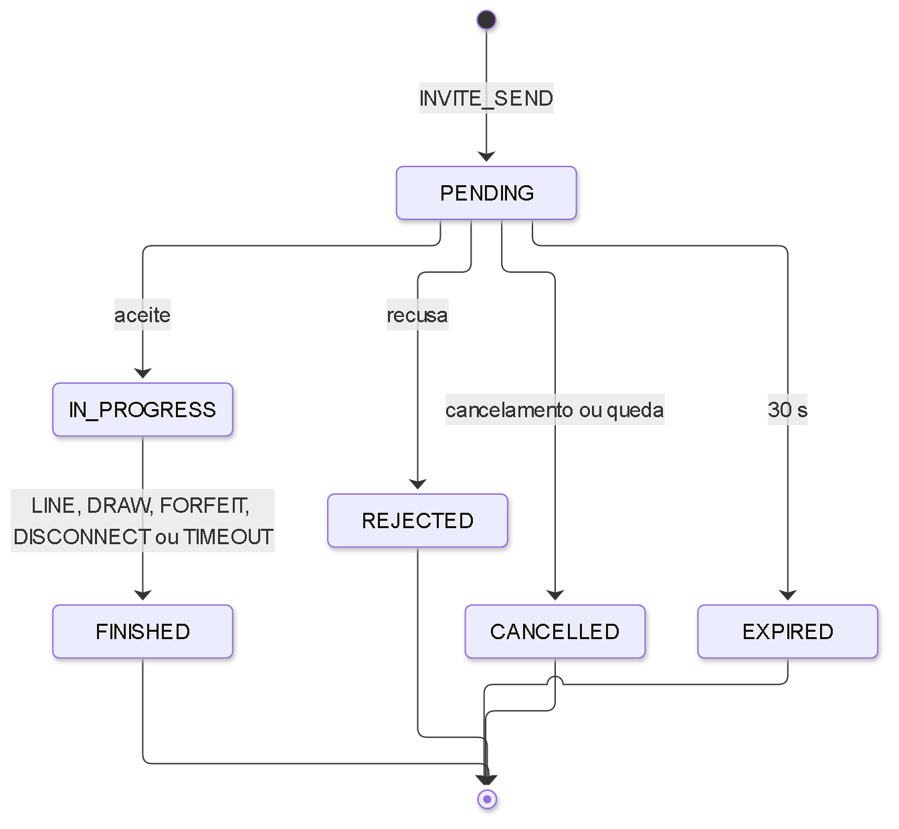

</div>

### 6.7 Estados do cliente {#estados-cliente}

O cliente combina o estado da conexão (`idle`, `connecting`, `open`, `reconnecting`, `replaced`, `closed`) e o da partida (`idle`, `playing`, `ended`); os diagramas usam esses nomes entre parênteses.

<div style="display: flex; gap: 12px; align-items: flex-start; page-break-inside: avoid">
<div style="width: 48%;">

**Diagrama D11a: estados do cliente, fluxo normal**

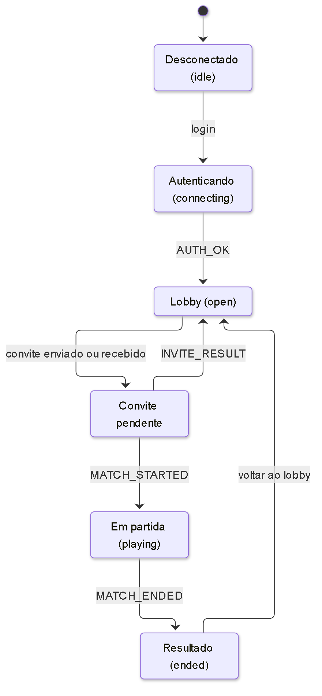

</div>
<div style="width: 48%;">

**Diagrama D11b: estados do cliente, falhas de conexão**

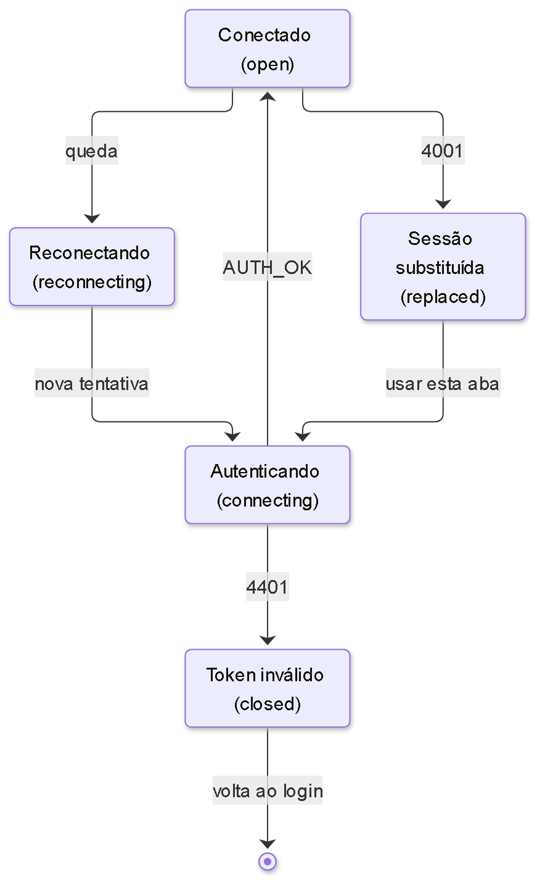

</div>
</div>

No D11b, "Conectado" representa qualquer estado com a conexão aberta: lobby, convite pendente ou partida. Se o `AUTH_OK` trouxer uma partida ativa, o cliente volta direto para ela. Os códigos 4001 e 4401 interrompem as tentativas, pelos motivos da seção 4.3.

### 6.8 Roteamento de mensagens {#roteamento}

Os destinatários de cada mensagem saem das estruturas em memória do servidor (conexões por `user_id` e jogadores por `match_id`), nunca do conteúdo enviado pelo cliente. O único comando que cita outro usuário é o `INVITE_SEND`, verificado como na seção 6.2, e um comando sobre partida alheia é recusado com `NOT_A_PLAYER`.

`ERROR`, `PRESENCE_SNAPSHOT` e as respostas a `MATCH_SYNC` vão só para o remetente. As mensagens de convite vão só para o convidante e o convidado. `MATCH_STARTED`, `MATCH_STATE` e `MATCH_ENDED` vão para os dois jogadores da partida, e `OPPONENT_DISCONNECTED` e `OPPONENT_RECONNECTED`, só para o adversário. Apenas `PRESENCE_UPDATE` vai para todos os conectados.

Esse roteamento por partida permite várias partidas simultâneas. Como cada partida é uma entrada independente indexada por `match_id`, o número de partidas simultâneas é limitado apenas pela memória do servidor.

## 7. Modelo de dados {#modelo-de-dados}

### 7.1 Coleções {#colecoes}

<div style="page-break-inside: avoid">

**Diagrama D4: coleções e campos**

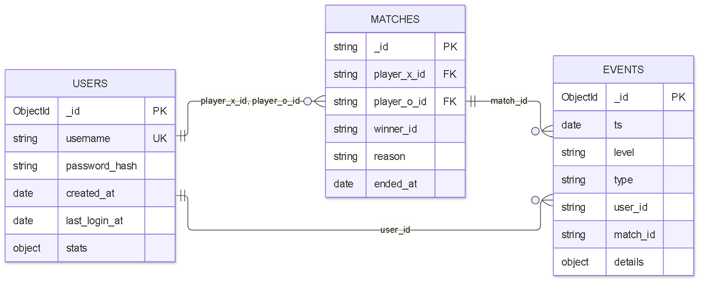

</div>

| Coleção | Conteúdo | Quem grava |
| --- | --- | --- |
| `users` | Nome em minúsculas, hash Argon2id, datas e `stats` (`wins`, `losses`, `draws`, `points`) | `UserRepository` |
| `matches` | Resultado de cada partida: `match_id`, jogadores, vencedor (`null` no empate), motivo e data | `MatchRepository` |
| `events` | Eventos: `ts`, `level`, `type`, `user_id`, `match_id` e `details` | `EventRepository` (seção 9) |

As ligações entre as coleções são feitas pelos ids em texto. O MongoDB não verifica essas referências; a consistência é responsabilidade do código, como mostrado em 7.3.

### 7.2 Índices {#indices}

| Coleção | Índice | Motivo |
| --- | --- | --- |
| `users` | `username`, único | Impede contas duplicadas, mesmo em cadastros simultâneos (409) |
| `users` | `stats.points` desc, `stats.wins` desc | Ordenação do ranking |
| `events` | `ts` desc; `type` | Eventos recentes e filtro por tipo |
| `matches` | Nenhum além do `_id` | Volume pequeno; índice por jogador entre os próximos passos (seção 12) |

Os índices são criados na inicialização do servidor, se o banco estiver acessível.

### 7.3 Regras de pontuação e consistência {#pontuacao}

| Resultado | Pontos | Campos incrementados |
| --- | --- | --- |
| Vitória (por linha, desistência, tempo ou queda) | 3 | `wins` e `points` do vencedor |
| Empate | 1 para cada um | `draws` e `points` dos dois |
| Derrota | 0 | `losses` do perdedor |

O ranking ordena por pontos (decrescente), depois por vitórias (decrescente), por derrotas (crescente) e, por fim, pelo nome. A consulta devolve só `username` e `stats`, nunca o `password_hash`.

As estatísticas são atualizadas com `$inc`, uma operação atômica do MongoDB, e nunca lidas, somadas e regravadas. Com leitura e regravação, duas partidas do mesmo jogador terminando ao mesmo tempo poderiam fazer uma atualização sobrescrever a outra. As duas atualizações vão em um único `bulk_write`. Como não usamos transação, o código confere antes que os dois ids existem. Sem essa conferência, um id inválido deixaria só um dos jogadores atualizado.

O backend acessa o banco com um usuário próprio da aplicação, criado por `infra/mongo/init-app-user.js` na primeira subida, com papel `readWrite` apenas no banco do jogo. As credenciais vêm de variáveis de ambiente e não aparecem no código.

### 7.4 Decisão: `matches` guarda só o resultado {#decisao-matches}

O planejamento inicial previa uma coleção `matches` com o estado de cada partida desde o convite, atualizado a cada jogada com `$push`. Optamos por gravar apenas o resultado de cada partida encerrada: o estado vivo muda a cada poucos segundos, é consultado a cada jogada e fica em memória, e o ranking e o histórico precisam só do resultado. Os convites e as jogadas continuam registrados na coleção `events` (`invite.*`, `move.applied`), com `user_id` e `match_id`. Em troca, um reinício do servidor encerra as partidas em andamento sem registrar resultado, e não é possível reconstruir uma partida jogada a jogada a partir de `matches`; essas limitações estão na seção 12.

## 8. Segurança {#seguranca}

### 8.1 Ameaças e mitigações {#ameacas}

| Ameaça | Mitigação |
| --- | --- |
| Escuta da rede e homem no meio | TLS 1.2 ou 1.3, certificado do Let's Encrypt validado pelo navegador e HSTS de 1 ano |
| Força bruta no login | Argon2id (t = 3, 64 MiB de memória, paralelismo 4). Após 5 falhas em 60 s para o mesmo usuário e IP, resposta 429; a resposta 401 não revela se o usuário existe |
| Roubo ou forja de token | JWT HS256 com segredo de no mínimo 32 caracteres, expiração em 60 min e algoritmo fixo. O token vai na mensagem `AUTH`, nunca na URL |
| Cross-Site WebSocket Hijacking | `Origin` comparado com `ALLOWED_ORIGINS`; origem desconhecida recusada com 1008 (HTTP 403) |
| Inundação e mensagens enormes | 10 mensagens/s com rajada de 20; depois de 3 avisos `RATE_LIMITED`, fechamento com 4400. Frames acima de 4 KB fecham com 1009; corpo HTTP limitado a 16 KB |
| Dados malformados ou injeção | Pydantic com tipos estritos; consultas montadas pelo código, nunca com objetos do cliente |
| Sessão duplicada | Uma conexão por usuário; a anterior é fechada com 4001 |
| Vazamento em log | Senha e token nunca registrados; chaves sensíveis removidas antes de gravar (seção 9.2) |
| IP falsificado no log | Cabeçalho de proxy aceito só do Nginx (seção 3.6) |
| Banco e VM expostos | MongoDB sem porta pública e com usuário próprio; na VM, só 22, 80 e 443 |
| Informação exposta pelo servidor web | `server_tokens off`, `X-Content-Type-Options: nosniff` e `X-Frame-Options: DENY` |


### 8.2 Funções de hash utilizadas {#funcoes-hash}

As funções da família SHA-2 produzem 224, 256, 384 ou 512 bits. Usamos três mecanismos com funções de hash, cada um com um papel:

| Uso | Mecanismo | Função de hash |
| --- | --- | --- |
| Confidencialidade e integridade do tráfego | TLS 1.3 com a suíte `TLS_AES_128_GCM_SHA256`, negociada em produção (Figura 7) | SHA-256 na derivação de chaves (HKDF) |
| Integridade do token de sessão | Assinatura do JWT com HS256 | HMAC-SHA256 |
| Armazenamento de senhas | Argon2id | Argon2, uma função de derivação de chave lenta por projeto |

Um hash rápido como o SHA-256 não serve para guardar senhas justamente por ser rápido. Uma GPU calcula bilhões de SHA-256 por segundo, o que permite testar dicionários inteiros contra um banco vazado. O Argon2id foi projetado para ser lento e exigir memória, e o sal aleatório impede que duas contas com a mesma senha tenham o mesmo hash.

### 8.3 Evidências: sem TLS e com TLS {#evidencias-tls}

As Figuras 4 e 5 vêm da captura local, sem TLS, e mostram o que um observador na mesma rede veria.

<div style="page-break-inside: avoid">

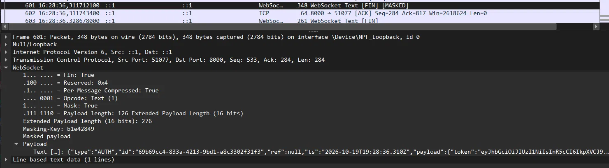

*Figura 4. Mensagem `AUTH` sem TLS: o token JWT aparece em texto claro no payload (frame 601).*

</div>

Com esse token, qualquer pessoa na rede poderia abrir o próprio WebSocket e se passar pelo usuário até o token expirar.

<div style="page-break-inside: avoid">

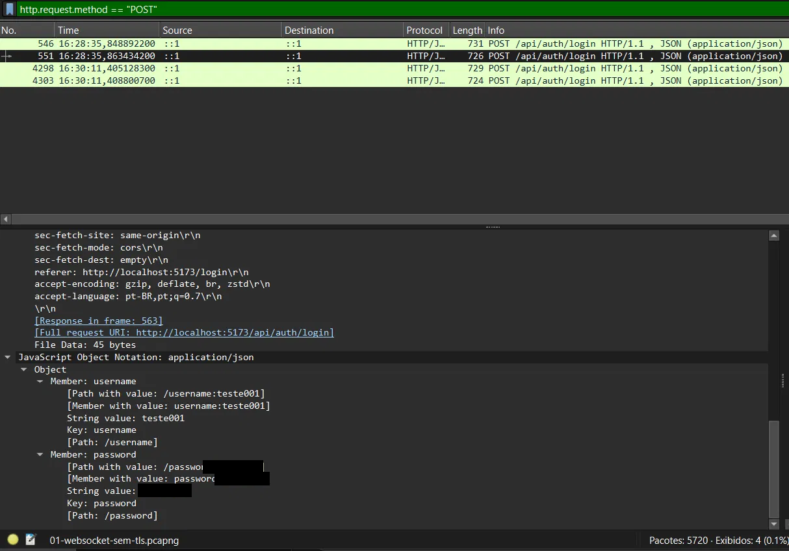

*Figura 5. `POST /api/auth/login` sem TLS: usuário e senha legíveis no corpo JSON.*

</div>

As Figuras 6 a 9 vêm da captura de produção, feita entre um navegador e a VM no Azure.

<div style="page-break-inside: avoid">

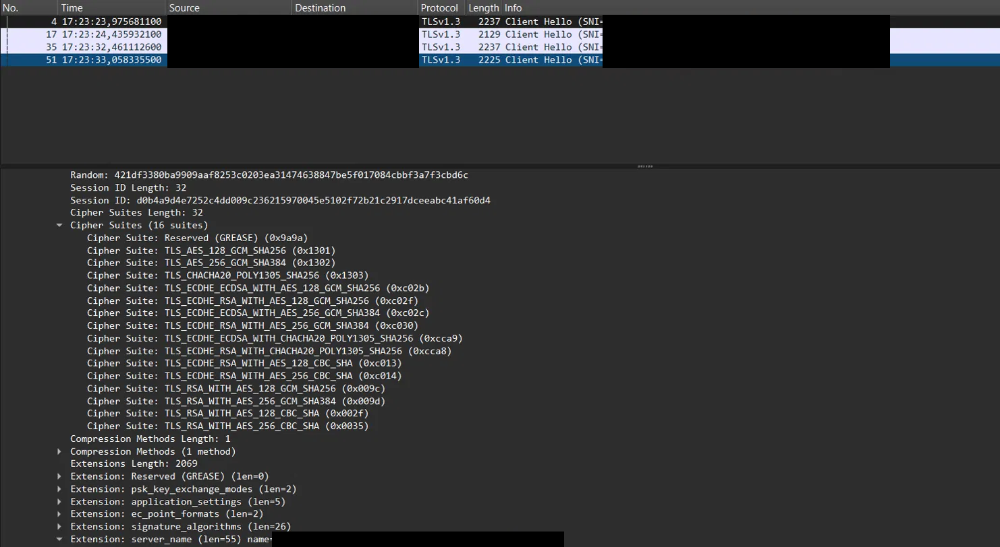

*Figura 6. Client Hello: o SNI com o domínio e as 16 suítes de cifra oferecidas pelo navegador.*

</div>

O SNI mostra a um observador qual site foi acessado, mas nada do conteúdo: nenhuma rota, mensagem ou credencial.

<div style="page-break-inside: avoid">

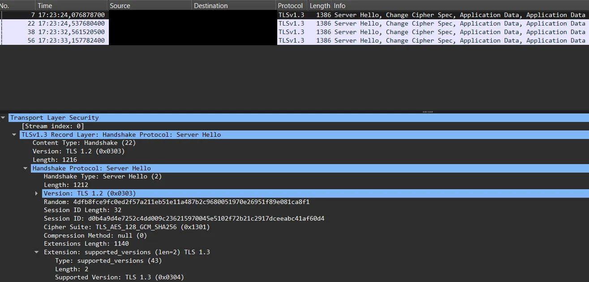

*Figura 7. Server Hello: suíte `TLS_AES_128_GCM_SHA256` escolhida e TLS 1.3 na extensão `supported_versions`.*

</div>

O campo `Version` mostra TLS 1.2 (0x0303) por compatibilidade com equipamentos intermediários antigos; a versão real está na extensão `supported_versions`: TLS 1.3 (0x0304).

<div style="page-break-inside: avoid">

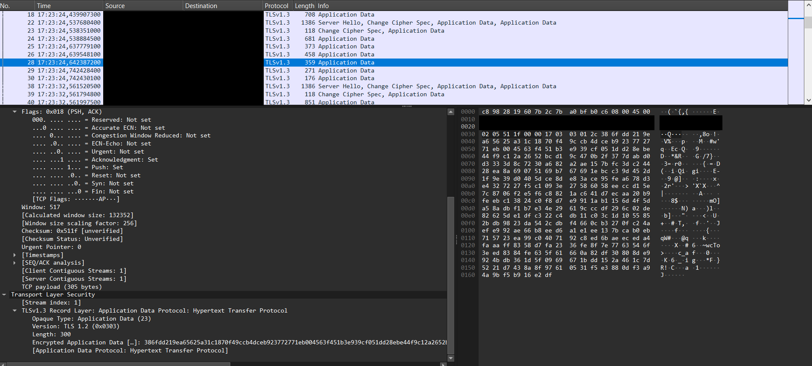

*Figura 8. Depois do handshake, a porta 443 só transporta registros `Application Data` cifrados.*

</div>

Requisições REST, upgrade do WebSocket, `AUTH`, jogadas e respostas trafegam dentro desses registros.

<div style="page-break-inside: avoid">

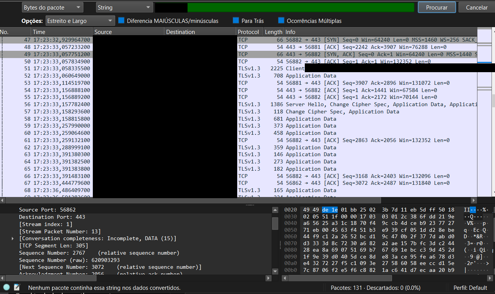

*Figura 9. Busca pela senha de teste (`<senha de teste>`) nos bytes dos 131 pacotes da captura de produção: nenhum resultado.*

</div>

A Figura 9 é a evidência do teste T24 e do requisito RNF01: a mesma senha que aparece no corpo do `POST` da captura local (Figura 5) não é encontrada na captura de produção.

### 8.4 Simulação de ataques {#simulacao-ataques}

Testes de penetração completos ficaram fora do escopo. Simulamos os abusos mais comuns com testes automatizados, que também confirmam que o servidor continua respondendo depois de cada um.

| Ataque simulado | Resultado esperado |
| --- | --- |
| Rajada de mensagens acima do limite | 3 respostas `RATE_LIMITED` e fechamento com 4400 |
| Mensagem acima de 4 KB | Fechamento com 1009 |
| Handshake com `Origin` de outro site | Conexão recusada |
| Conexão sem `AUTH` | Fechamento com 4401 após 5 s |
| Token inválido ou primeira mensagem diferente de `AUTH` | Fechamento com 4401 |
| Tentativas repetidas de login | 429 na 6ª falha em 1 minuto |
| Campos com tipo errado no cadastro | 422, sem gravar nada |
| Token adulterado, sem assinatura, expirado ou com outro segredo | Token recusado |

Esses casos estão nos testes `test_ws_protection.py`, `test_ws.py`, `test_auth.py` e `test_security.py`, em `backend/tests/`. A demonstração de escuta é a comparação da seção 8.3 (Figuras 4 e 5 contra 8 e 9).

### 8.5 Estados da conexão WebSocket no servidor {#estados-conexao}

O D12 resume os caminhos de uma conexão WebSocket no servidor, e a tabela abaixo dele mostra os códigos de fechamento.

<div style="page-break-inside: avoid">

**Diagrama D12: estados da conexão WebSocket no servidor**

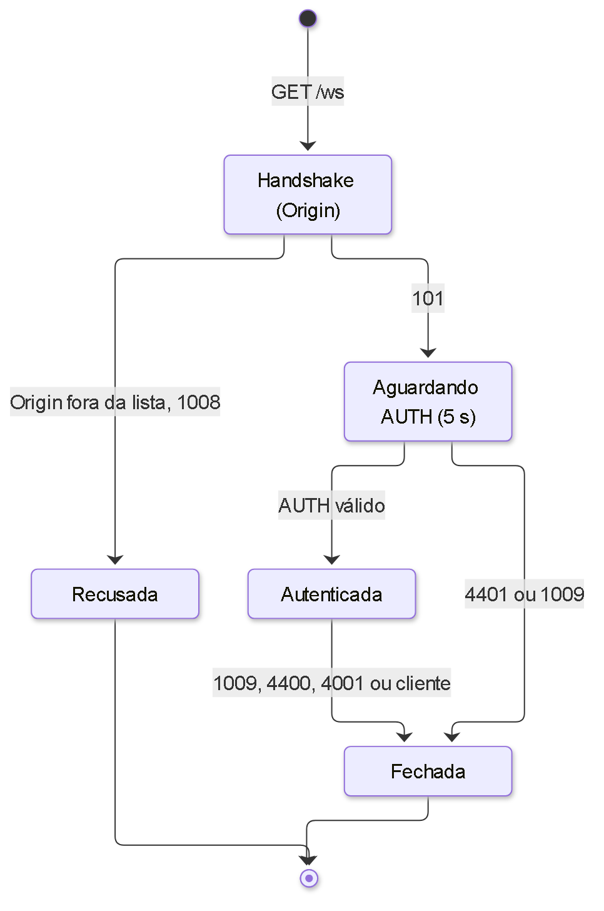

</div>

<div style="page-break-inside: avoid">

| Código | Situação | Ação do cliente |
| --- | --- | --- |
| 1008 | Origem não permitida no handshake | Nenhuma (a conexão nem é aceita) |
| 1009 | Mensagem maior que 4096 bytes | Reconectar |
| 4001 | A mesma conta abriu uma nova conexão | Avisar "sessão aberta em outra aba" e não reconectar |
| 4400 | Excesso de mensagens após 3 avisos `RATE_LIMITED` | Reconectar |
| 4401 | `AUTH` ausente em 5 s, primeira mensagem diferente de `AUTH` ou token inválido | Voltar à tela de login |

</div>

A conexão também termina quando o próprio cliente a fecha, por exemplo com 1001 ao fechar a aba (Figura 10).

## 9. Monitoramento e depuração {#monitoramento}

### 9.1 Logs estruturados {#logs}

O servidor escreve um evento por linha, em JSON, na saída padrão. Em desenvolvimento e em produção, os logs são lidos com:

```
docker compose logs -f backend
```

Cada linha tem `ts` (UTC, com milissegundos), `level`, `type` (o nome do evento) e `details`. Este é o evento registrado quando a conexão da Figura 1 foi encerrada, como aparece na Figura 13:

```json
{"ts": "2026-10-19T19:29:39.931+00:00", "level": "INFO", "type": "user.disconnected",
 "details": {"user_id": "6ad62f1b38c038bab8340fc8", "username": "teste001",
             "ip": "172.28.0.1", "port": 35926, "close_code": 1001, "duration_s": 63.6}}
```

O JSON permite filtrar por campo e gravar no banco sem conversão. Os eventos registrados são:

- **Servidor:** `server.started`, `server.stopped`.
- **Usuário:** `user.registered`, `user.login`, `user.login_failed`, `user.connected`, `user.disconnected`.
- **Convite:** `invite.sent`, `invite.accepted`, `invite.rejected`, `invite.cancelled`, `invite.expired`.
- **Partida:** `match.started`, `move.applied`, `move.rejected`, `game_engine.turn_timeout`, `match.player_disconnected`, `match.player_reconnected`, `match.reconnect_expired`, `match.ended`.
- **Segurança:** `security.rate_limited`, `security.bad_origin`, `security.auth_failed`.
- **Erros:** `error.internal`, `ws.send_failed`, `audit.drain_timeout`.

Os eventos levam `user_id` e `match_id` quando se aplicam, e o `user.disconnected` registra IP, porta, código de fechamento e duração, o que permite cruzar o log com a captura (seção 9.5).

### 9.2 Auditoria na coleção `events` {#auditoria}

Cada evento também é gravado na coleção `events`, o que atende à parte desejável do requisito 9. Um handler do `logging` remove as chaves sensíveis (`password`, `password_hash`, `token`, `access_token`, `authorization`, `secret` e `cookie`), sobe `user_id` e `match_id` para o nível de cima e coloca o documento em uma fila `asyncio.Queue` de até 1000 itens; uma tarefa separada grava os documentos no MongoDB. A fila evita que uma lentidão do banco atrase as jogadas. Com a fila cheia, o evento é descartado sem erro, e a auditoria pode ser desligada com `AUDIT_ENABLED=false`.

Consulta dos últimos eventos de segurança: o primeiro comando abre um shell no contêiner do MongoDB, e o segundo entra no mongosh com o usuário da aplicação.

```
docker compose exec mongo sh
mongosh -u "$MONGO_APP_USER" -p "$MONGO_APP_PASSWORD" "$MONGO_DB"
```

```javascript
db.events.find({ type: /^security\./ }).sort({ ts: -1 }).limit(10)
```

### 9.3 Outras ferramentas {#ferramentas}

| Ferramenta | Uso |
| --- | --- |
| `GET /api/health` | 200, ou 503 se o MongoDB não responder; usado pelos healthchecks do Compose |
| DevTools, aba Rede, filtro WS | Cada frame da conexão `/ws`, sem precisar de captura |
| Servidor falso (`npm run mock`) | Mesmo protocolo em memória, para o front-end e os testes E2E sem o backend |

### 9.4 Roteiro de capturas no Wireshark {#wireshark}

Seguimos um roteiro de seis capturas. As locais usaram a interface de loopback do Npcap. As capturas brutas (.pcapng) não foram publicadas por conterem dados de ambiente; este documento traz apenas os prints, com os dados sensíveis cobertos.

<div style="page-break-inside: avoid">

| # | Captura | Figuras |
| --- | --- | --- |
| 1 | WebSocket sem TLS | 1, 2, 3, 4 |
| 2 | Login sem TLS | 5 |
| 3 | Fluxo com TLS na porta 443 | 6, 7, 8, 9 |
| 4 | Ping/pong e fechamento | 10 |
| 5 | Latência de uma jogada | 11 |
| 6 | Queda de conexão | 12, 13 |

</div>

Filtros de exibição usados em cada captura:

1. `tcp.port == 51077`, depois `websocket`
2. `http.request.method == "POST"`
3. `tls`, depois `tls.handshake.type == 1`
4. `websocket.opcode == 9 || websocket.opcode == 10 || websocket.opcode == 8`
5. `websocket.payload.text contains "MOVE" || websocket.payload.text contains "MATCH_STATE"`
6. `tcp.port == 51077 && (tcp.flags.fin == 1 || tcp.flags.reset == 1)`

Na captura 5, filtramos pelo conteúdo em vez de `tcp.stream eq N` porque a jogada atravessa quatro conexões TCP (`tcp.stream` 183, 185, 119 e 117): navegador de A até o Vite, Vite até o backend pela conexão de A, backend até o Vite pela conexão de B e Vite até o navegador de B.

A captura de produção usou o filtro de captura `host <IP da VM>`, o IP público da VM, que descarta os outros pacotes antes de gravar. Assim, a captura contém só a conversa com o servidor: 131 pacotes e 43 KB, contra 5720 pacotes e 7,5 MB da captura local.

### 9.5 Prints das capturas e correlação com o log {#prints-correlacao}

<div style="page-break-inside: avoid">

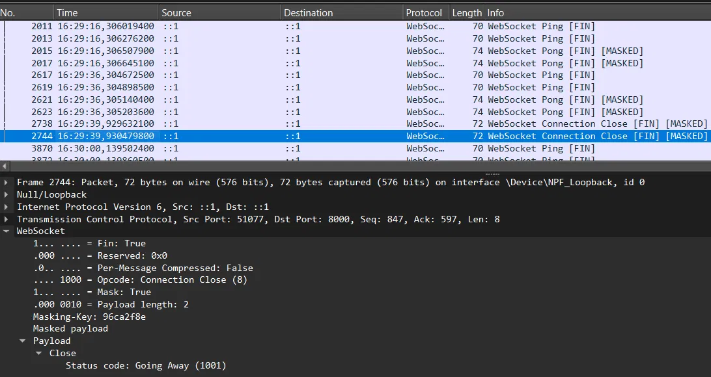

*Figura 10. Pings do servidor a cada 20 s, pongs mascarados do cliente e frame Close com o código 1001 (Going Away).*

</div>

É o keep-alive de protocolo do Uvicorn, que detecta conexões mortas. O Close 1001 vem do navegador, ao fechar a aba.

<div style="page-break-inside: avoid">

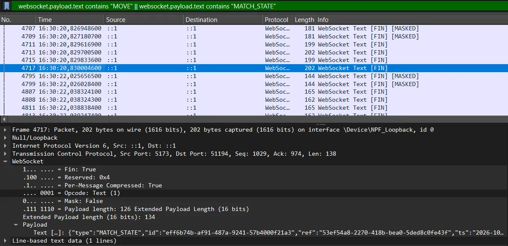

*Figura 11. Medição da latência: `MOVE` no frame 4707 (16:30:20,826948) e `MATCH_STATE` entregue ao adversário no frame 4717 (16:30:20,830004).*

</div>

**Latência (RNF04).** A diferença entre os dois frames é de cerca de 3 ms, de ponta a ponta entre os navegadores de A e de B: é o custo de processamento da aplicação, sem atraso de rede.

Como o ICMP está bloqueado na VM, medimos o tempo de ida e volta (RTT) pelo handshake TCP da captura de produção: 98 ms (frames 32 e 33) e 128 ms (frames 47 e 49). Somando meio RTT até o servidor, o processamento e meio RTT até o adversário, a estimativa fica entre 101 e 131 ms, abaixo do limite de 200 ms.

Os 3 ms e os RTTs foram medidos; o total pela internet é uma estimativa, porque não capturamos as duas pontas remotas ao mesmo tempo. Não medimos entre duas máquinas da mesma rede local, o cenário de referência do requisito RNF04.

<div style="page-break-inside: avoid">

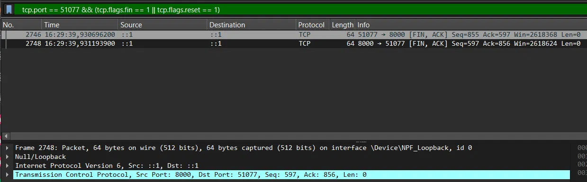

*Figura 12. Encerramento TCP depois do Close: os dois `FIN, ACK` às 16:29:39, sem `RST`.*

</div>

A ausência de `RST` indica que nenhum dos lados abortou a conexão.

<div style="page-break-inside: avoid">

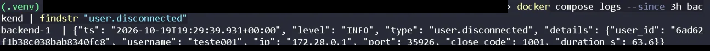

*Figura 13. Evento `user.disconnected` no log do backend: 19:29:39 UTC, `close_code` 1001 e `duration_s` 63.6.*

</div>

As Figuras 1, 10, 12 e 13 mostram o mesmo encerramento visto pela rede e pelo servidor:

| Dado | Wireshark | Log |
| --- | --- | --- |
| Horário | 16:29:39 (horário local, UTC-3) | `2026-10-19T19:29:39.931+00:00` (UTC) |
| Código de fechamento | Close com 1001 (Figura 10) | `"close_code": 1001` |
| Duração | SYN 16:28:36,3, FIN 16:29:39,9: cerca de 63,7 s | `"duration_s": 63.6`, contados a partir da autenticação |
| Origem | `::1`, porta 51077 | `172.28.0.1`, porta 35926 |

A origem não coincide porque o backend roda em um contêiner Docker e recebe a conexão pelo gateway da rede interna (172.28.0.1), que faz NAT; por isso a correlação é feita pelo horário, pelo código e pela duração. Em produção, o log registra o IP real do cliente (seção 3.6).

## 10. Implantação {#implantacao}

### 10.1 Ambiente local {#ambiente-local}

| Etapa | Comando | O que sobe |
| --- | --- | --- |
| Banco e servidor | `docker compose up -d --build` | MongoDB (local) e backend na 8000, com recarga |
| Front-end | `npm run dev` (em `frontend/`) | Vite na 5173, com proxy para o backend |
| HTTPS local (opcional) | `docker compose --profile https up -d --build` | Nginx na 443 com mkcert, como em produção |

O profile `https` reproduz localmente o caminho de produção, sem domínio público.

### 10.2 Produção {#producao}

A aplicação foi implantada em uma VM no Azure (hoje desativada), com a topologia do D2 (seção 3.6).

| Item | Configuração |
| --- | --- |
| Máquina | VM Ubuntu 24.04 LTS, região Chile Central, 3,8 GB de RAM e 2 GB de swap |
| Contêineres | Docker Engine 29.9 e Docker Compose 5.6 |
| Domínio | `<domínio de produção>`, rótulo DNS do IP público no Azure |
| Firewall | Grupo de segurança de rede do Azure liberando apenas as portas 22, 80 e 443; ICMP bloqueado |
| Certificado | Let's Encrypt, emitido pelo `infra/deploy/primeiro-certificado.sh` e renovado pelo contêiner `certbot` |

A produção usa o `compose.yaml` com o override `compose.prod.yaml`, no qual o backend e o MongoDB não publicam portas, o Nginx fica sempre ativo com o certificado do Let's Encrypt e HSTS, e um contêiner `certbot` tenta renovar o certificado a cada 12 h. Todos os serviços usam `restart: unless-stopped` e logs com rotação (até 3 arquivos de 10 MB).

Como o Nginx não sobe sem certificado, o script `primeiro-certificado.sh` emite o primeiro em modo standalone, sobe a stack e passa a renovação para o Nginx. A cada renovação, o certbot marca um arquivo compartilhado, e o Nginx se recarrega em até 5 minutos, sem que o certbot precise de acesso ao Docker.

Os passos da implantação são:

1. Liberar as portas 22, 80 e 443 no grupo de segurança de rede do Azure.
2. Instalar o Docker Engine com o plugin compose.
3. Clonar o repositório na VM com uma credencial somente leitura (deploy token ou deploy key).
4. Criar o `.env` de produção, com domínio, `JWT_SECRET` e senhas novas.
5. Emitir o certificado e subir a stack com `primeiro-certificado.sh`.

Para atualizar, basta `git pull` e `docker compose up -d --build`; o backup do MongoDB é feito com `mongodump`. O passo a passo completo está no repositório, em `infra/deploy/README.md`.

## 11. Testes {#testes}

### 11.1 Organização {#organizacao-testes}

<div style="page-break-inside: avoid">

| Nível | Testes | Comando | Resultado |
| --- | --- | --- | --- |
| Unidade (backend) | 44 em 8 arquivos | `pytest tests/unit` | Todos passaram |
| Integração (backend, MongoDB real) | 75 em 12 arquivos | `pytest tests/integration` | Todos passaram |
| Ponta a ponta (Playwright, dois navegadores) | 22 em 2 arquivos | `npm run e2e` | Todos passaram |

</div>

Os testes de unidade cobrem as regras do jogo, o motor de partidas, a segurança (hash e JWT), o limite de mensagens e o event bus, sem rede nem banco. Os de integração sobem a aplicação com o cliente de testes do FastAPI e falam REST e WebSocket com o MongoDB do Docker Compose; cada teste remove os dados que criou. A suíte completa do backend (119 testes) roda em cerca de 48 s.

Os testes ponta a ponta abrem dois contextos de navegador, um para cada jogador. Na execução registrada aqui, eles rodaram no modo padrão, contra o servidor falso (`npm run mock`) e o Vite. Eles validam o front-end e o contrato do protocolo; o comportamento do servidor real é validado pelos testes de integração. O front-end não tem testes unitários: a verificação dele é feita pelos testes ponta a ponta, pelo ESLint, pelo Prettier e pelo build com TypeScript estrito, todos sem erros.

### 11.2 Plano de testes funcionais {#plano-testes}

Os casos T01 a T24 foram definidos no plano de testes do projeto. A coluna "Verificação" indica onde cada um é conferido.

| ID | Cenário | Verificação | Situação |
| --- | --- | --- | --- |
| T01 | Cadastro válido, senha só como hash | `test_auth.py` | Automatizado, passou |
| T02 | Nome repetido (409) | `test_auth.py` | Automatizado, passou |
| T03 | Senha errada e usuário inexistente com o mesmo 401 | `test_auth.py` | Automatizado, passou |
| T04 | 6ª falha em 1 minuto (429) | `test_auth.py` | Automatizado, passou |
| T05 | WebSocket sem `AUTH` ou com token inválido (4401) | `test_ws.py`, E2E | Automatizado, passou |
| T06 | Dois usuários se veem online | `test_ws.py`, E2E | Automatizado, passou |
| T07 | Convite aceito, convidante é X | `test_match_end.py`, E2E | Automatizado, passou |
| T08 | Convite recusado, expirado ou cancelado | `test_invites.py`, E2E | Automatizado, passou |
| T09 | Convidar usuário ocupado, a si mesmo ou offline | `test_invites.py` (só `USER_BUSY`) | Parcial: `SELF_INVITE` e `USER_OFFLINE` sem teste |
| T10 | Jogada fora do turno | `test_tictactoe.py`, `test_log_events.py`, E2E | Automatizado, passou |
| T11 | Casa ocupada ou casa 9 | `test_tictactoe.py`, E2E | Automatizado (unidade e E2E), passou |
| T12 | `seq` antigo (clique duplo) | `test_match_end.py`, `test_game_engine.py` | Automatizado, passou |
| T13 | Terceiro usuário envia `MOVE` em partida alheia | `test_game_engine.py` (`FORFEIT`), `test_invites.py` (`MATCH_SYNC`) | Parcial: a mesma verificação, mas sem teste com `MOVE` |
| T14 | X vence e ganha 3 pontos | `test_match_end.py`, E2E | Automatizado, passou |
| T15 | Empate | `test_match_end.py`, E2E | Automatizado, passou |
| T16 | Desistência | `test_match_end.py`, E2E | Automatizado, passou |
| T17 | Jogador fecha a aba e não volta | `test_match_end.py`, `test_game_engine.py` | Automatizado (integração), passou |
| T18 | Jogador cai e volta | `test_reconnect.py`, E2E | Automatizado, passou |
| T19 | JSON malformado, tipo desconhecido, mensagem acima de 4 KB | `test_ws.py`, `test_ws_protection.py` | Automatizado, passou |
| T20 | 5 partidas simultâneas | Nenhum teste | Não automatizado |
| T21 | Ranking depois de T14 a T16 | `test_ranking.py`, E2E | Automatizado, passou |
| T22 | Eventos em `events`, sem senha nem token | `test_audit.py`, `test_log_events.py` | Automatizado, passou |
| T23 | Segunda aba derruba a primeira (4001) | `test_invites.py`, E2E | Automatizado, passou |
| T24 | Porta 443 sem conteúdo legível | Captura do Wireshark (Figura 9) | Manual, conferido |

Os testes de integração estão em `backend/tests/integration/`, os de unidade em `backend/tests/unit/` e os ponta a ponta em `frontend/e2e/`.

### 11.3 Todos os resultados possíveis {#resultados-possiveis}

O objetivo foi cobrir todos os resultados possíveis de uma partida. Cada um tem pelo menos um teste automatizado:

<div style="page-break-inside: avoid">

| Resultado | Teste de integração | Teste ponta a ponta |
| --- | --- | --- |
| Vitória de X por linha | `test_match_end.py` | T07/T14/T21 |
| Vitória de O | `test_match_end.py` (O vence por tempo) | Não há |
| Empate | `test_match_end.py` | T15 |
| Desistência | `test_match_end.py` | T16 |
| Tempo esgotado | `test_match_end.py` | Teste `TIMEOUT` (vitória de X) |
| Desconexão sem volta | `test_match_end.py` | Não há |

</div>

A vitória de O por linha não tem teste próprio; a detecção de linha não depende do símbolo e é testada nas 8 linhas com X (`test_tictactoe.py`). A verificação de segurança com o Wireshark e a simulação de ataques estão nas seções 8.3 e 8.4.

## 12. Decisões e qualidade {#decisoes-e-qualidade}

### 12.1 Qualidade do código {#qualidade-codigo}

O servidor segue camadas com dependência em um só sentido, e o módulo `domain/` não importa nada de rede nem de banco (seção 3.5). O código Python usa type hints e passa no ruff sem avisos; o TypeScript usa modo estrito, sem `any`, e passa no ESLint e no Prettier sem avisos. A configuração vem só de variáveis de ambiente. Cada mudança entra na branch de integração por merge request, e o `CONTRIBUTING.md` exige rodar antes o lint, a formatação, os testes do backend e o build do front-end.

### 12.2 Principais decisões {#decisoes}

- WebSocket nativo, e não `Socket.IO` ou MQTT: protocolo próprio e legível no Wireshark (seção 4.3).
- Servidor autoritativo: consistência entre os clientes e proteção contra trapaça (seção 3.3).
- Event bus dentro do processo, no papel de corretor, sem broker externo (seções 3.4 e 4.3).
- `matches` só com o resultado e estado vivo em memória (seção 7.4).
- Argon2id para senhas, em vez de um hash rápido (seções 8.1 e 8.2).
- TLS terminado no Nginx, que também serve o front-end (seções 3.6 e 8.1).
- Implantação em uma VM no Azure com Docker Compose e Let's Encrypt (seção 10.2).

### 12.3 Limitações conhecidas {#limitacoes}

- **Trava global.** Partidas diferentes esperam umas pelas outras na mesma trava (seção 3.4).
- **Estado em memória e um único worker.** Um reinício encerra as partidas em andamento, e não há escala horizontal (seção 3.3).
- **`matches` sem índice por jogador.** O histórico consulta a coleção sem índice além do `_id`, o que é suficiente para o volume do projeto, mas não para muitas partidas.
- **Funcionalidades opcionais.** O jogador bot e o painel de administração não foram implementados.
- **Testes ausentes.** T09 e T13 estão cobertos só em parte, e T20 (5 partidas simultâneas) não tem teste automatizado.
- **Aviso no fim de algumas partidas.** Nos testes manuais, um aviso de erro apareceu no fim de algumas partidas. Pela análise do código, a causa provável é um segundo comando, normalmente um `MOVE` de clique duplo na casa que fecha a partida, chegar ao servidor depois do fim e ser recusado com `INVALID_STATE`, que o front-end mostra como aviso; nas jogadas comuns, o segundo clique recebe `STALE_STATE`, que é silencioso. O mesmo acontece com um `FORFEIT` ou um clique no instante em que a partida termina por tempo ou por desistência do outro jogador.

### 12.4 Próximos passos {#proximos-passos}

- Trocar a trava global por uma trava por partida.
- Criar o painel de administração com os dados que já estão em `events`.
- Mover presença, convites e partidas para um estado compartilhado (por exemplo, Redis), permitindo mais de um worker.
- Criar um índice por jogador em `matches`.
- Implementar o jogador bot.
- Escrever os testes que faltam: `SELF_INVITE`, `USER_OFFLINE`, `MOVE` de terceiro e 5 partidas simultâneas.

## 13. Referências {#referencias}

- RFC 6455, The WebSocket Protocol: https://www.rfc-editor.org/rfc/rfc6455
- RFC 8446, The Transport Layer Security (TLS) Protocol Version 1.3: https://www.rfc-editor.org/rfc/rfc8446
- RFC 7519, JSON Web Token (JWT): https://www.rfc-editor.org/rfc/rfc7519
- RFC 9106, Argon2 Memory-Hard Function for Password Hashing: https://www.rfc-editor.org/rfc/rfc9106
- OWASP Password Storage Cheat Sheet: https://cheatsheetseries.owasp.org/cheatsheets/Password_Storage_Cheat_Sheet.html
- FastAPI: https://fastapi.tiangolo.com/
- Uvicorn: https://www.uvicorn.org/
- Pydantic: https://docs.pydantic.dev/
- PyMongo: https://pymongo.readthedocs.io/
- MongoDB: https://www.mongodb.com/docs/
- Nginx: https://nginx.org/en/docs/
- Certbot: https://eff-certbot.readthedocs.io/
- Let's Encrypt: https://letsencrypt.org/docs/
- Docker Compose: https://docs.docker.com/compose/
- Playwright: https://playwright.dev/
- Wireshark: https://www.wireshark.org/docs/
